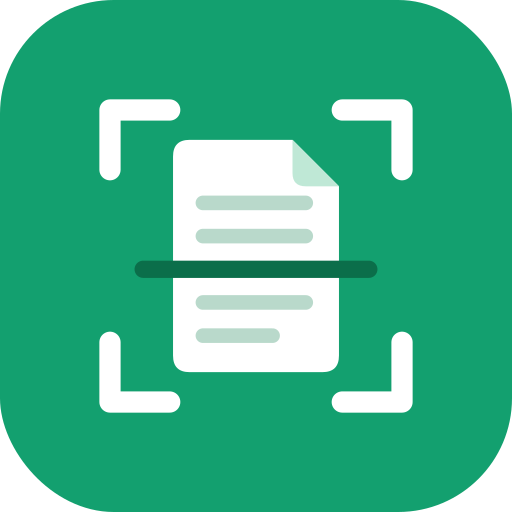

# Abdul's Scanner

  

A personal Android document-scanner app modelled on OKEN (CamScanner-style), with every scanning feature and none of the ads, logins, premium upsells, or data-loss risks. Everything runs entirely offline on your phone.

## Features

- **Document Scanning:** Scan multi-page documents, books, ID cards (both sides on one A4 sheet), and QR codes.
- **Offline OCR:** English and Arabic text recognition directly on your phone.
- **Organization:** Tags, full-text search with Arabic normalization, custom sort, list and grid view.
- **Complete PDF Toolkit:** Merge, split, compress, watermark, password-protect, sign, reorder pages, PDF to JPG, and file import.
- **Office Conversion:** Convert Word (.docx) and Excel (.xlsx) files directly to PDF on device.
- **Data Protection:** Automatic local backups, recycle bin with 30-day retention, PIN/fingerprint lock, and public Documents-folder mirror.

## How to Install on Your Phone

1. Open the [Releases](https://github.com/SyedMsidsm/AbdulsScanner/releases) page on your Android phone's web browser.
2. Download the latest `AbdulsScanner-x.y.z.apk`.
3. If prompted by your browser, tap **Settings** and enable **Allow from this source** ("Install unknown apps").
4. Tap **Install** (or **Update**). Updating keeps all your documents and settings safe.

## Backing Up Your Signing Key

The app is signed with a private release key. Keep **two copies** of `abdulsscanner-release.jks` in different places (such as a private USB drive and secure cloud storage) along with your passwords. Without this key, future updates cannot install over the existing app.
